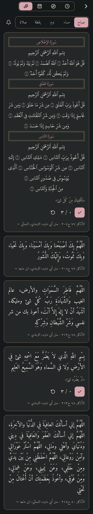
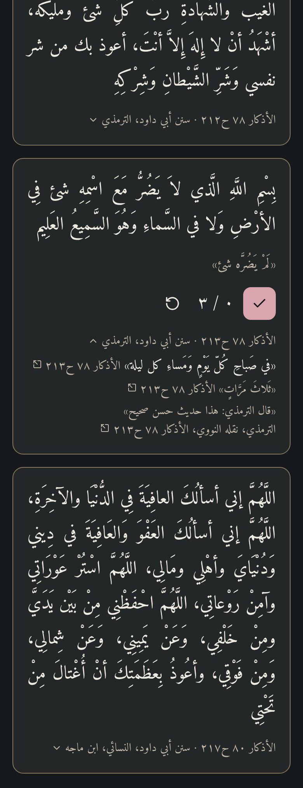
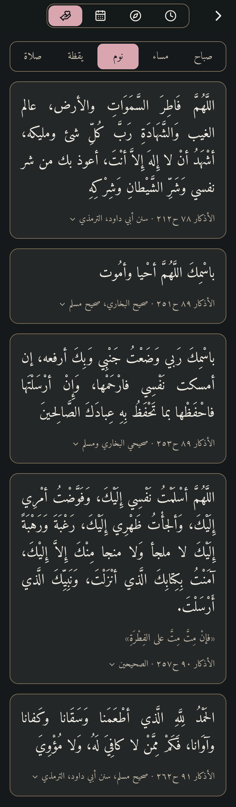
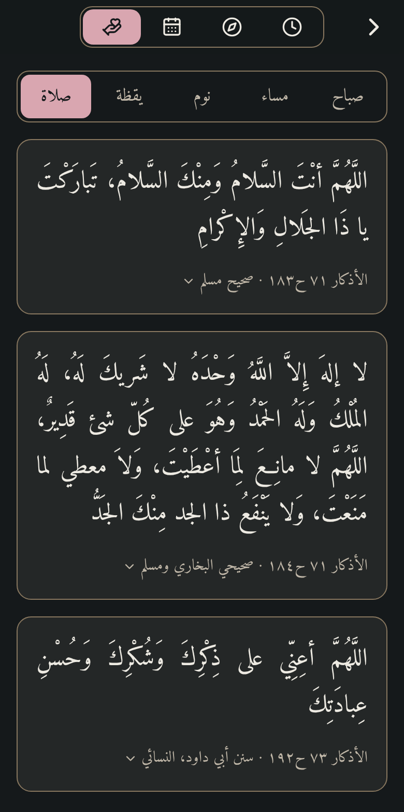

# Adhkar content and sketch

Round 1, 2026-11-17. The owner authorized the selection, tests, source entries,
book-rule correction and dark-mode sketch. The utilities screen, reminders,
counter behavior and search integration wait for the owner's go on this PR.
Nothing here registers a production screen or imports the selection at startup.

## Sources and selection

The text comes from al-Nawawi, *al-Adhkar*, edited by Abd al-Qadir al-Arna'ut,
Dar al-Fikr, revised edition 1414 AH / 1994, one volume,
[Shamela 1956](https://shamela.ws/book/1956). The page-numbered
[digital witness](https://files.turath.io/books-v3/1956.json) supplies the printed
pages and report numbers. These numbers belong to this edition, not the original
collections. Collection names in the data are al-Nawawi's attributions; those
primary collections were not independently collated for this selection.

The second source is Ibn Hajar, *Nata'ij al-Afkar fi Takhrij Ahadith al-Adhkar*,
edited by Hamdi Abd al-Majid al-Salafi, Dar Ibn Kathir, Damascus and Beirut,
second edition 1429 AH / 2008, five volumes,
[Shamela 30108](https://shamela.ws/book/30108),
[digital witness](https://files.turath.io/books-v3/30108.json). Its catalogue warns
that modern supplements and quotations from other works fill some gaps. The
selected passages are in the original author layer, not those supplements or
editor footnotes.

[The typed selection](../../shared/adhkar.ts) holds the exact utterance, source,
occasion evidence, grades and any sourced repetition, instruction or virtue.
[The test witness](../../shared/adhkar/author-excerpts.json) preserves the selected
author passages and the grading context. The test witness is not imported by the
selection or the app. Report 207's Quran wording is omitted as separate fragment
boundaries; the item holds only the positions of surahs 112, 113 and 114.

All 15 items have at least one named sahih or hasan judgment. No inclusion is a
new Namaq grade or a claim of agreement among every scholar. Judgments of
al-Tirmidhi and al-Hakim are quoted as reported by al-Nawawi, not as checked
transcriptions of those scholars' own books. No al-Albani annotation, Hisn
al-Muslim selection/order, editor footnote or editor heading was copied.

| Item | Occasion | al-Adhkar, volume 1, page / report | Named judgment location | Counter |
| --- | --- | --- | --- | --- |
| `waking-life` | Waking | [19 / 37](https://shamela.ws/book/1956/17) | Ibn Hajar, 1:109, [117](https://shamela.ws/book/30108/117) | None |
| `waking-spirit` | Waking | [20 / 38](https://shamela.ws/book/1956/18) | al-Nawawi there; Ibn Hajar, 1:113, [122](https://shamela.ws/book/30108/122) | None |
| `prayer-peace` | After prayer | [71 / 183](https://shamela.ws/book/1956/69) | Ibn Hajar, 2:252, [827](https://shamela.ws/book/30108/827) | None |
| `prayer-giving` | After prayer | [71 / 184](https://shamela.ws/book/1956/69) | Ibn Hajar, 2:256, [832](https://shamela.ws/book/30108/832) | None |
| `prayer-help` | After prayer | [73 / 192](https://shamela.ws/book/1956/71) | al-Nawawi there | None |
| `morning-evening-protection` | Morning/evening | [77 / 207](https://shamela.ws/book/1956/75) | al-Tirmidhi, reported there | Three complete selections, each containing all three surahs |
| `morning-by-you` | Morning | [77 / 208](https://shamela.ws/book/1956/75) | al-Tirmidhi, reported there | None |
| `evening-by-you` | Evening | [77 / 208](https://shamela.ws/book/1956/75) | al-Tirmidhi, reported there | None |
| `morning-evening-sleep-creator` | Morning/evening/sleep | [78 / 212](https://shamela.ws/book/1956/76) | al-Tirmidhi, reported there | None |
| `morning-evening-name` | Morning/evening | [78 / 213](https://shamela.ws/book/1956/76) | al-Tirmidhi, reported there | Three utterances |
| `morning-evening-wellbeing` | Morning/evening | [80 / 217](https://shamela.ws/book/1956/78) | al-Hakim, reported there; the collection attribution begins on page79 | None |
| `sleep-life` | Sleep | [89 / 251](https://shamela.ws/book/1956/87) | Ibn Hajar, 1:109; his explicit return to that grading is 3:28, [1073](https://shamela.ws/book/30108/1073) | None |
| `sleep-side` | Sleep | [89 / 253](https://shamela.ws/book/1956/87) | Ibn Hajar, 3:35, [1082](https://shamela.ws/book/30108/1082) | None |
| `sleep-surrender` | Sleep | [90 / 257](https://shamela.ws/book/1956/88) | Ibn Hajar, 3:45, [1092](https://shamela.ws/book/30108/1092) | None |
| `sleep-fed` | Sleep | [91 / 262](https://shamela.ws/book/1956/89) | al-Tirmidhi, reported there | None |

The waking report 38 retains al-Nawawi's sahih-isnad judgment and Ibn Hajar's
hasan judgment. Ibn Hajar identifies the waking half specifically in 1:113.
There is no weak judgment in that comparison. Al-Nawawi's witness also inserts
a later quotation from al-Suyuti in the main text after report 38. That paragraph
is excluded from our author-only witness. See [R0059](../records/R0059-a-later-author-can-be-in-the-main-text.md).

Report 208's two utterances stay separate. The evening text retains the witness's
wording, including its ending, rather than substituting a different edition's
wording. Report 213 uses the al-Tirmidhi version al-Nawawi identifies, including
its virtue. The Abu Dawud virtue variant is not combined with it.

No count defaults to one. In report 183, the three repetitions apply to
istighfar, not to the following salam du'a; this pilot selects only that du'a.
In report 253, the three repetitions apply to dusting the bed, not the du'a.
Neither item gets a counter. The Quran selection's counter counts a complete
reading of the three surahs, never individual ayat. In round 2 it must render
through the agreed Quran module, preserving all mushaf signs.

## Dark-mode sketch

The sketch imports the real app Card, Tabs, TopBar, Reference, Button, IconButton,
Amiri Text and the reader's MushafPageView. It uses the dark palette, one card
colour and right-aligned text.

- Each occasion tab lists all of its items, not a sample.
- The Quran item shows Madina page 604 whole, since al-Ikhlas and
  al-Mu'awwidhatayn fill that page. It goes through the reader's own page view
  with the Hafs font, so nothing stores Quran text.
- A virtue shows under the text only where the hadith states it, in quotation
  marks. The counter shows only where the hadith states a count.
- Each card ends with its own collapsed reference (book, page, report, the
  collections al-Nawawi names). Opened, it quotes al-Nawawi's words on when and
  how often, then every grade in the scholar's words with its own book and page.
  There is no source sheet: the owner's rule is one collapsible reference per
  section.
- The bell for the fajr and asr reminders sits beside the tabs on the morning and
  evening tabs only.
- The icon row at the top only shows where the fourth icon sits. Round 2 adds it
  to the real UtilityPicker.









The [sketch source](../../mobile/sketches/adhkar/index.tsx) is outside `src/app/`.
Render it independently without changing production routes:

```sh
node mobile/sketches/adhkar/render.mjs
node e2e/serve.mjs /tmp/namaq-adhkar-sketch 8093
```

Open port 8093 in a browser set to dark mode. The renderer temporarily selects
this sketch as the Expo Router root and removes its temporary config afterward.
It refuses to overwrite an existing dynamic config. Screenshots are the Expo web
render at 390 wide, not iOS or Android device verification.

## Limits and handoff

This is a small selection, not a complete occasion collection. The following are
left out rather than supplied without the requested source evidence:

- The separate three-istighfar card from report183 and the multi-part counted
  tasbih sequences after prayer and at bedtime. They need sequence-specific
  counter units, not a count copied onto the following du'a.
- Ayat al-Kursi and the last two ayat of al-Baqara at bedtime. Their Quran
  references, full supporting report and named-grade scope need their own
  entries. They are not claimed to be absent from the book.
- Optional additions or alternate virtues/counts where this selection does not
  carry a matching strong judgment for that exact variant.

The data tests compare every displayed utterance, occasion, count, instruction,
virtue and grading quote to the saved author-only witness. They also test all
occasion selectors, exact-id selection, variant separation, Quran positions and
counts that belong to an action instead of the following utterance. These are
ordinary content/behavior tests, not a proposed architectural guard.

Round 2 will add the fourth utilities page, a React-state-only counter resetting
on card change, blur and background, opt-in fajr/asr reminders in the shared
60-alert/14-day budget, separate cancellation keys, and exact-card search. It
will use the existing Quran text pipeline for Quran selections. No audio,
whole-book reader, stats, history or review labels are planned. No new pipeline
or guard is authorized by this sketch.
