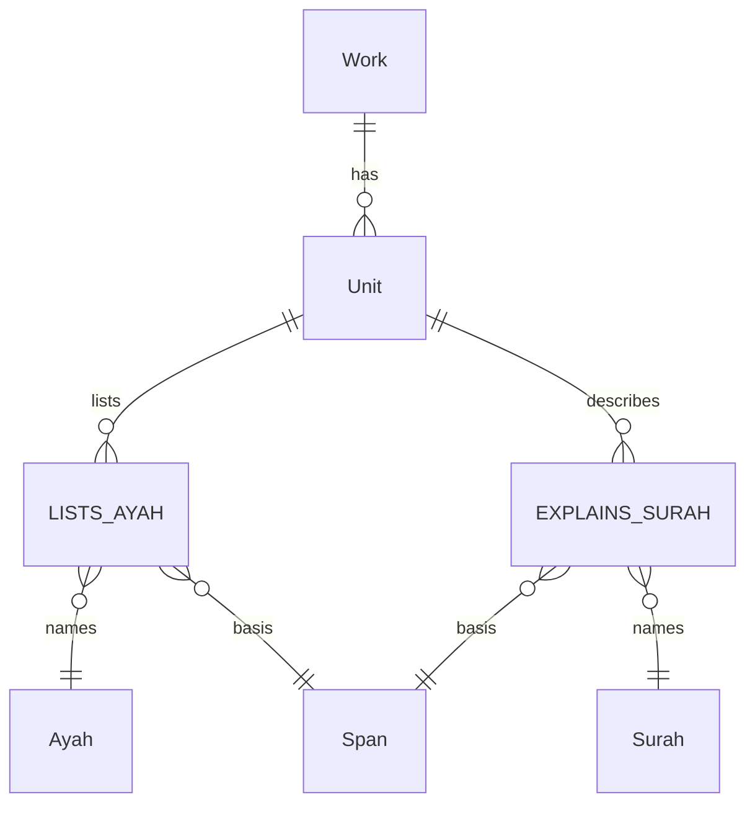
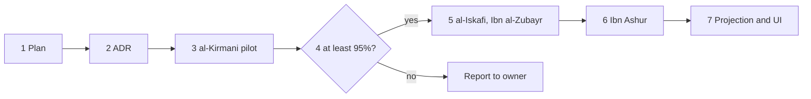

# Qur'an groupings from attributed works

Status: planned. Settled on 2026-10-17 after a design interview between two
agents, with the owner's answers to the open gates.

## Why this plan exists

The owner asked for the topics of each ayah, starting with 64:1-9 and 57:1-11.
A first pass wrote free-form topic labels per ayah. The owner objected that such
labels would not generalize across surahs, and agreed to a closed topic
vocabulary built from a sample of surahs.

That vocabulary breaks R2 in [owner-goals.md](data-model/owner-goals.md): Namaq
never authors groupings or tags of ayat. A grouping is allowed only when a work
makes it, attributed to that work and scoped to it. So agents do not invent
topics, and they do not decide which topic an ayah belongs to. They extract
what a published work says and display it under that work's name.

## Decisions

| # | Decision |
|---|---|
| D1 | A published work's own grouping of ayat, attributed to it, is a span basis in the sense of owner-goals.md:80 (takhrij, atraf) and :96 (a commentator's own statement). It is shown as "في <work>: …", never as a heading of the Qur'an. *Confirmed by the owner.* |
| D2 | Comparison across surahs is bounded by what the attributed works say. A gap is shown as a gap and never filled by an agent. *Confirmed by the owner.* |
| D3 | Modern editions on Shamela follow the same copyright policy as the Risala edition of the Siyar, which the repo already quotes page by page. *Confirmed by the owner.* |
| D4 | تفصيل آيات القرآن الحكيم is out of scope. *Owner's decision.* |
| D5 | The authored vocabulary and the authored facets (speech type, divine attribute) are dropped. |
| D6 | Repetition by identical wording is already built: the passage matcher in [passages.ts](../../src/lib/quran/passages.ts) and the repetition view. It needs no source because it computes over the Qur'an's own text. |
| D7 | No table, ID or UI control equates a grouping of one work with a grouping of another. Works are shown side by side, each under its own name. |
| D8 | Links are recorded as not reviewed and are visible on preview (ADR 0008). A review attests that a link matches the work at its recorded edition. No agent sets reviewed. Prod shows a link only after review (R1a). |

## Sources

A work must pass this gate before extraction: a named author, a fixed and
citable edition (publisher, editor, printing), text that can be read page by
page, and Arabic.

| Work | Shamela | What it gives | Use |
|---|---|---|---|
| al-Kirmani, أسرار التكرار في القرآن | [3580](https://shamela.ws/book/3580) | Numbered entries in surah order. Entry 503 groups سبح in 57, 59 and 61 against يسبح in 62 and 64. | Pilot |
| al-Iskafi, درة التنزيل وغرة التأويل | [1340](https://shamela.ws/book/1340) | Entries in surah order. The al-Hadid entry quotes the openings of 59, 61, 62 and 64 beside 57:1. | After the pilot |
| Ibn al-Zubayr al-Gharnati, ملاك التأويل | [1419](https://shamela.ws/book/1419) | Entries in surah order. Contrasts سبح in 57, 59 and 61 with يسبح in 62 and 64. | After the pilot |
| Ibn Ashur, التحرير والتنوير | [9776](https://shamela.ws/book/9776) | A أغراض passage in each surah's introduction: 57 at vol. 27 p. 355, 64 at vol. 28 p. 259. No ayah ranges. | Per surah |

Rejected: Quranpedia's topic index (no named compiler, a living dataset, no
topics for any ayah of the sample), Tarteel QUL (no licence, English), the
Quranic Arabic Corpus ontology (GPL, English), the Sharjah التفسير الموضوعي
(in copyright, no licence).

## Model

One ADR ([0030](../adr/0030-a-grouping-of-ayat-is-a-work-s-own-statement.md))
on the rethink model in [plan.md](data-model/plan.md). The old batch
schema (`subjectKinds` in `src/lib/history/batchSchema.ts`) is not extended.

- A genre `ULUM_QURAN` beside the existing `TAFSIR`, because a mutashabih work
  is not a running commentary.
- `Unit LISTS_AYAH Ayah`. An entry of a mutashabih work is a Unit of that work,
  and it lists the ayat it quotes or names. The basis is the quoted span.
- `Unit EXPLAINS_SURAH Surah`, for a statement about a whole surah such as Ibn
  Ashur's أغراض. It is not expanded into a link per ayah, because the author
  said nothing about each ayah.
- No edge from one ayah to another. "These ayat are parallels" is derived as
  "listed in the same Unit of work W", and is shown as W's statement.

## Resolving a quotation to an ayah

Every link passes two checks, each with its own normalization:

1. **The fragment is in the book.** `matchSpan` (plan.md:94) proves that the
   fragment is on the book's page. It stays strict and unchanged.
2. **The fragment names one ayah.** The Qur'an normalizer in
   [normalize.ts](../../src/lib/quran/normalize.ts), extended with a documented
   and versioned mapping from imla'i to Uthmani spelling, finds the fragment in
   the Ayah text of the surah the author names.

A link is made only when exactly one ayah in the named surah matches. Zero or
several matches are flagged with no link, and the flags are counted. A flag
caused by a gap in the spelling mapping is counted apart from a flag caused by
an ambiguous fragment. Each link records the resolver version.

Readings that need recording in the work's `summary.md`:

- «وكذلك <surah>» applies the quoted fragment to each surah named, as the text
  says (ADR 0024).
- Bracketed ayah numbers such as «(الحديد: ١)» are the editor's. They go in
  the page's `.notes.md` and serve only as a cross-check (ADR 0011). A
  disagreement with the resolved key is flagged.
- Shamela's own section headings are not the author's and are never cited as
  his division.

Ayah keys use the Hafs count of the `Ayah` table. A quotation of another
reading, such as 57:24 without هو, is counted separately.

## Targets

- Mutashabih works: at least 95% of quoted fragments resolve to one ayah.
  Coverage of the sample is reported, with no target. These works explain
  ayat that have parallels; they do not tag every ayah.
- Surah 31 serves as a held-out check on the resolution rate.

## Steps

Steps 2 to 6 are separate PRs through the review cycle in AGENTS.md. Each starts
after the previous one has merged.

1. This plan.
2. The ADR: the genre, the two predicates, the two-step resolution and D7.
   Drafted as [ADR 0030](../adr/0030-a-grouping-of-ayat-is-a-work-s-own-statement.md),
   status proposed until the owner has read this plan.
3. Pilot, files only. Record al-Kirmani's edition, then extract every entry
   that quotes ayat of 57 or 64 (entry 503, and the al-Taghabun entries
   including the one pairing 64:9 with 65:11). Page files go under
   `data/history/sources/<edition>/<witness>/v<n>/<page>.md`, with footnotes in
   `.notes.md` (plan.md, section 2.2).
4. Measure: resolution rate, flags by cause, editor-bracket disagreements,
   coverage of 64:1-9 and 57:1-11, and the surah 31 check.
5. If the target is met: al-Iskafi and Ibn al-Zubayr for the same surahs, each
   under its own name. Agreement between the works is counted as a diagnostic,
   never merged.
6. Ibn Ashur's أغراض for 57 and 64, as `EXPLAINS_SURAH`.
7. Projection into the database and the UI.

## Open questions for the owner

- Whether step 7 waits for the data-model rethink to resume or this work
  becomes the rethink's first slice. Steps 2 to 6 are files only and proceed
  either way.
- Whether new work stops building on the existing 12 themes (`themeId`, the 589
  range rows under `data/quran/topics/`, [quran-topics-engine.md](quran-topics-engine.md)
  and the hops table in `src/lib/quran/surahOrder.ts`). They are groupings
  Namaq wrote, so they conflict with R2. This plan does not touch them and
  shares no table, ID or colour scale with them, so retiring them later is a
  deletion.

## Risks

- The owner's first request, topics for every ayah that compare across
  surahs, is not met. In the sample, the mutashabih works cover roughly 57:1,
  64:1, 64:4 and 64:9. With تفصيل out of scope, no source in this plan tags
  every ayah.
- The spelling mapping may be incomplete, so the 95% target could fail on
  mapping gaps rather than on the sources. Counting the two causes separately
  shows which.
