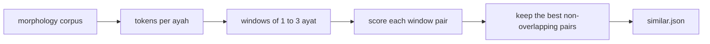

# Similar ayat on `/quran/compare`

Status: built.

## Why

The shared-passage finder on `/quran/compare` needs ten matching words in a
row, so it misses short ayat that a memoriser confuses because they say nearly
the same thing in different words. المدثر ٥٤–٥٥ «كلا إنه تذكرة فمن شاء ذكره» and
عبس ١١–١٢ «كلا إنها تذكرة فمن شاء ذكره» differ in one letter and share no run of
ten words. المزمل ١٩ and الإنسان ٢٩ («إن هذه تذكرة فمن شاء اتخذ إلى ربه سبيلا»)
are the same pattern again. These are close to what the books of متشابه القرآن
collect, and the page had no way to find them.

## How a match is found

1. **Tokens come from the morphology corpus**
   (`data/quran/quranic-corpus-morphology-0.4.txt`). A noun, verb, adjective or
   proper noun becomes its root, so تذكرة and ذكره are the same token. Any other
   word with a lemma (كلا, بل, إن, من, ما) becomes its lemma. Prepositions,
   conjunctions, the article and pronoun suffixes are dropped.
2. **A token's weight is its rarity**: the log of the number of ayat over the
   number of ayat that hold it. A particle counts half, so a shared كلا helps a
   match but cannot make one alone.
3. **Windows are 1 to 3 consecutive ayat** inside one surah, because a pattern
   one surah says in one ayah another says in two.
4. **A pair's score** is half the weighted overlap of the two token sets (cosine)
   and half the weighted longest common subsequence, so the same words in the
   same order rank above the same words scattered. Two windows that open with
   the same two tokens gain 0.1, since a memoriser goes wrong at the opening.
5. **A pair is kept** when its score is at least 0.5 and the tokens it shares
   weigh at least 6.5, which rules out a match on one common root, unless the
   score is 0.8 or more, as with الواقعة ١ and الحاقة ١٥, which share only the
   root و ق ع but say the same thing. Of overlapping
   pairs only the best is kept. A window whose first or last ayah shares no
   token with the other side is dropped, so a match is never padded with a
   neighbour. Pairs whose letters are identical are kept across surahs, since a
   memoriser needs them too, and dropped inside one surah, where the
   within-surah phrase list already shows them.
6. Only ayah pairs that share a rare root (in fewer than about one ayah in
   twelve) are scored, and only where the shared weight is already near a match,
   which keeps the build to seconds.

## Where it shows

The result is generated once with `npm run quran:similar` into
`src/app/quran/compare/similar.json`, since scoring the whole text takes too
long for a request. The text never changes, so the file only changes when the
rules above do. The surah view (`?s=`) lists every similar pair touching that
surah. A pair view narrowed to ayah ranges lists every match that touches
them. In the pair view the list of matches between the two surahs is the
default, and a switch turns to the older ayah-by-ayah alignment (`view=ayat`),
since both answer which ayat of the two surahs belong together.

A word the other side has letter for letter is amber, as in the alignment; a
leading و or ف is ignored, so وإنه counts as إنه. A particle is marked only
as part of a run of marked words that holds a content word or two words or
more, or that sits in the same place in its counterpart ayah (two windows of
equal length pair their ayat in order). So إنه opens both الواقعة ٧٧ and الحاقة
٤٠ and is marked, while the لا of وما لا تبصرون stays plain against the فلا of
an oath. A
word that shares only its root or particle with the other side, such as إنه
against إنها, is sky blue, since that is the difference a memoriser has to
learn.

## Later

A list drawn from the books of متشابه القرآن (al-Kirmani's *البرهان*, Ibn
al-Zubayr's *ملاك التأويل*) would add matches no root count can find, and would
say why the wording differs. It needs the books parsed first.
