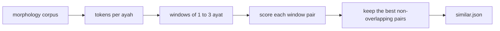

# Similar ayat on `/quran/compare`

Status: built.

## Why

The shared-passage finder on `/quran/compare` needs ten matching words in a
row, so it misses short ayat that a memoriser confuses because they say nearly
the same thing in different words. المدثر ٥٤–٥٥ «كلا إنه تذكرة فمن شاء ذكره» and
عبس ١١–١٢ «كلا إنها تذكرة فمن شاء ذكره» differ in one letter and share no run of
ten words. المزمل ١٩ and الإنسان ٢٩ («إن هذه تذكرة فمن شاء اتخذ إلى ربه سبيلا»)
are the same pattern again. These are close to what the books of متشابه القرآن
collect, and the page had no way to find them.

## How a match is found

1. **Tokens come from the morphology corpus**
   (`data/quran/quranic-corpus-morphology-0.4.txt`). A noun, verb, adjective or
   proper noun becomes its root, so تذكرة and ذكره are the same token. Any other
   word with a lemma (كلا, بل, إن, من, ما) becomes its lemma. Prepositions,
   conjunctions, the article and pronoun suffixes are dropped.
2. **A token's weight is its rarity**: the log of the number of ayat over the
   number of ayat that hold it. A particle counts half, so a shared كلا helps a
   match but cannot make one alone.
3. **Windows are 1 to 3 consecutive ayat** inside one surah, because a pattern
   one surah says in one ayah another says in two.
4. **A pair's score** is half the weighted overlap of the two token sets (cosine)
   and half the weighted longest common subsequence, so the same words in the
   same order rank above the same words scattered. Two windows that open with
   the same two tokens gain 0.1, since a memoriser goes wrong at the opening.
5. **A pair is kept** when its score is at least 0.5 and the tokens it shares
   weigh at least 6.5, which rules out a match on one common root and on
   particles. A short pair scoring 0.8 or more is kept with less only when it
   shares two roots, or one root twice in a row: الواقعة ١ and الحاقة ١٥ share
   only و ق ع but repeat it in وقعت الواقعة. One root with particles is not
   enough, so إني لكم رسول أمين no longer matches إنك لمن المرسلين, nor the
   ما أدراك ما … openings each other. Of overlapping pairs only the best is
   kept. A window whose first or last ayah shares no token with the other side
   is dropped, so a match is never padded with a neighbour. Pairs whose letters
   are identical are always kept across surahs, since a memoriser needs them
   too, and dropped inside one surah, where the within-surah phrase list
   already shows them.
6. **A long common run counts on its own.** The score above divides by the
   length of both ayat, so two long ayat sharing ten words in a row, such as
   البقرة ١٧٠ and لقمان ٢١, scored under 0.5. A pair of single ayat also scores
   the weight of its longest run of tokens in the same order with nothing
   between, over 32, so a run weighing 16 is kept: about six rare words in a
   row. Scattered shared words never form such a run, which a common
   subsequence would let them do. Only single ayat score this way, since a
   wider window would only pad the same run. With it, every shared passage of
   ten words between two surahs is also a similar pair, except the one whose
   run is split across two ayat (يونس ٣٧–٣٨ and السجدة ٢–٣).
7. Only ayah pairs that share a rare root (in fewer than about one ayah in
   twelve) are scored, and only where the shared weight is already near a match
   or the rare roots they share weigh 9 or more. A pair let in by that weight
   alone is scored on its run only, which keeps the build under a minute.

## Where it shows

The result is generated once with `npm run quran:similar` into
`src/app/quran/compare/similar.json`, since scoring the whole text takes too
long for a request. The text never changes, so the file only changes when the
rules above do. The surah view (`?s=`) lists every similar pair touching that
surah. A pair view narrowed to ayah ranges lists every match that touches
them. In the pair view the list of matches between the two surahs is the
default, and a switch turns to the older ayah-by-ayah alignment (`view=ayat`),
since both answer which ayat of the two surahs belong together.

The page used to show the shared passages of a pair (ten words or more in a
row, from `GET /api/quran/repetition`) in a section of their own above the
similar ayat. Nearly every one was also a similar pair, so the section showed
the same ayat twice. Rule 6 makes the similar list hold them all but one, and
a similar pair that overlaps a shared passage on both sides now carries its
word count, and the number of places the wording occurs when it is more than
the two.

Beside the comparison, the surahs are listed by how many similar pairs they
take part in, or in the topic view by how many topics they share with another
surah. Each surah opens to the surahs it pairs with, so a pair is listed under
both of its surahs, and in the text view to the count of pairs inside the
surah itself, which opens the surah view. The two surahs being compared start
open with the pair marked.

A word the other side has letter for letter is amber, as in the alignment; a
leading و or ف is ignored, so وإنه counts as إنه. When the two windows have the same number of ayat, ayah k of one is paired
with ayah k of the other, and a particle is marked only against its paired
ayah, so the وإنه of الواقعة ٧٦ stays plain against the إنه of الحاقة ٤٠.
Otherwise a particle is marked only as part of a run of marked words that holds
a content word or two words or more. A mark is kept only when the other side
marks a word of the same root or particle, so no highlight lacks a partner.

Each marked word names what it answers on the other side when the pointer
rests on it. An amber word whose root also answers a blue word on the other
side gets a dotted blue underline: أقسم in الحاقة ٣٨ is the same word as in
الواقعة ٧٥ and the root of لقسم in الواقعة ٧٦. A
word that shares only its root or particle with the other side, such as إنه
against إنها, is sky blue, since that is the difference a memoriser has to
learn.

## Later

A list drawn from the books of متشابه القرآن (al-Kirmani's *البرهان*, Ibn
al-Zubayr's *ملاك التأويل*) would add matches no root count can find, and would
say why the wording differs. It needs the books parsed first.
